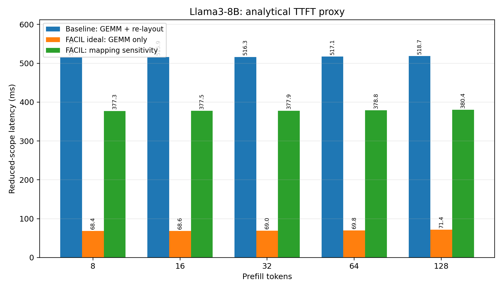
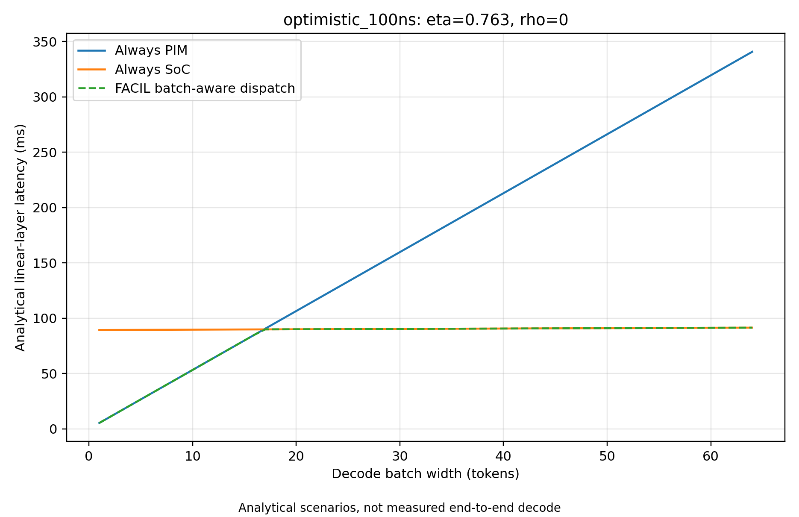

# FACIL: address mapping and batch-aware SoC–PIM dispatch

Reduced-scope IIT Guwahati coursework reproduction of **FACIL (HPCA 2025)**, built on DRAMsim3. The implementation validates shared-weight address mapping, measures serialized DRAM traffic, and evaluates an original analytical policy for batched decode.

**Part A:** conventional re-layout versus FACIL-style shared access, standalone mapping, native MapID decoding/routing, and analytical prefill/PIM timing. **Part B:** batch-aware decode-step dispatch, crossover sensitivity, dynamic workloads, switching costs, memory comparisons, and an access-order diagnostic.

The native changes model address mapping and channel routing. They implement neither PIM MAC execution nor OS page-table extensions. All SoC/PIM execution latencies are explicitly analytical; simulator traffic measurements are identified separately.

**Preparing for the viva?** The [40-question evidence map](docs/FACIL_VIVA.md) links each answer to source code, configuration, tests, or raw results and lists the demonstration assignments for all four members.

## Attribution

Original paper: Seong Hoon Seo, Junghoon Kim, Donghyun Lee, Seonah Yoo, Seokwon Moon, Yeonhong Park, and Jae W. Lee, **“FACIL: Flexible DRAM Address Mapping for SoC-PIM Cooperative On-device LLM Inference,” HPCA 2025**, pp. 1720–1733. [DOI](https://doi.org/10.1109/HPCA61900.2025.00127) · [Author-hosted paper](https://99dhl.github.io/assets/pdf/hpca25_facil.pdf).

Simulator: [University of Maryland DRAMsim3](https://github.com/umd-memsys/DRAMsim3), S. Li et al., *DRAMsim3: A Cycle-accurate, Thermal-Capable DRAM Simulator*, IEEE Computer Architecture Letters, 2020, [DOI](https://doi.org/10.1109/LCA.2020.2973991). The upstream [MIT license](LICENSE), vendored dependency licenses, native source layout, and Git history are retained. This repository contains student modifications and is not the authors’ original FACIL simulator.

## Repository map

```text
mapping/                 Reference mapper, placement and structural validators
experiments/
  baseline/              Corrected traffic generator and serialized-copy measurement
  facil/                 Native matched-read experiments, regeneration and figures
  analytical/            SoC GEMM, PIM GEMV, timing budget and TTFT models
  extension/             Batch feasibility and Experiments 1–5
results/
  mapping/               Placement, reduction and alignment evidence
  baseline/              Original corrected copy-stage statistics and summaries
  facil/                 Native verification, matched reads, TTFT figures, padding evidence
  analytical/            Original model CSV/JSON outputs and PIM figures
  extension/             Original batch CSVs, assumptions, plots and diagnostic statistics
traces/                  Checksummed manifests and small essential diagnostic inputs
src/, configs/, ext/     Modified simulator, configuration files and dependencies
tests/                   Mapper/evidence tests and native C++ validation sources
scripts/validate_release.py  Repeatable validation without full-size simulations
docs/                    Methodology, reproduction commands, result index and limitations
paper/                   One canonical supplied manuscript, figures and report PDF
```

Large regenerable traces and compiled executables are excluded from the Git tip. Original manifests, checksum inventory and exact regeneration commands remain. See [repository manifest](REPOSITORY_MANIFEST.md) and [clean tree](REPOSITORY_TREE.txt).

## Build and validate

Ubuntu 24.04, Python 3.12, GCC/G++ 13 and CMake 3.28 were used for the recorded validation. Other compatible Linux environments may work; they are not independently validated here.

```bash
python3 -m venv .venv
source .venv/bin/activate
python -m pip install -r requirements.txt
cmake -S . -B build -DCMAKE_BUILD_TYPE=Release
cmake --build build -j 2
PYTHONDONTWRITEBYTECODE=1 python scripts/validate_release.py
```

The validator runs the existing mapper/C++ tests, read-only numerical evidence checks, native decoder and small routing/EOF tests, isolated analytical reproductions, and matched-trace regeneration. It does not rerun full-matrix workload simulations. To also regenerate and checksum all four baseline input streams:

```bash
PYTHONDONTWRITEBYTECODE=1 python scripts/validate_release.py --regenerate-traces
```

See [validation report](VALIDATION_REPORT.md), [exact reproduction instructions](docs/REPRODUCIBILITY.md), and [validated environment](docs/provenance/VALIDATED_ENVIRONMENT.json).

## Baseline: on-demand re-layout traffic

`experiments/baseline/generate_verified_baseline_traces_2k.py` encodes verified PIM placement into conventional physical DRAM addresses. Each of four Llama3-8B projection classes has separate source-read and destination-write traffic. `measure_relayout.py` measures stage completion brackets through native DRAMsim3 statistics.

Across 32 blocks and multiplicities `(2, 2, 2, 1)`, the saved stage sums total **447.28352 ms**. This is a **serialized DRAM-only traffic proxy**. It omits CPU/GPU byte rearrangement and read/write overlap and is neither measured end-to-end conversion nor a rigorous TTFT bound. Write callbacks acknowledge buffering; they must not be interpreted as durable DRAM write completion.

The workload contains 224 FP16 linear projections and 13,958,643,712 weight bytes. Embeddings, output head, norms and attention/KV storage are outside that accounting.

## FACIL physical-to-DRAM mapping

`mapping/facil_mapper.py` implements the MapID selector, reversible bit-field mapping and per-huge-page choices. The paper-example geometry is distinct from the evaluated four-channel proxy geometry. Placement audits cover Q/O, K/V, FFN gate/up and FFN down; compact FFN-down rows require cross-PU reduction and do not imply an efficient hardware kernel.

Native changes in `src/configuration.cc`, `src/configuration.h` and `src/dram_system.cc` select the DRAM tuple and route to the same decoded channel. Registered 2-MiB pages use the supplied MapID; unregistered pages retain conventional mapping. `src/cpu.cc` prevents reissuing the last trace request at EOF.

The native verifier checks **411 independent tuples**, exhaustive MapID 2/3 page uniqueness and conventional fallback. The mixed-page smoke reproduces channel read counts `(72, 8, 8, 8)`. Native validation fixtures and original statistics are under [results/facil/facil_native_validation](results/facil/facil_native_validation).

## Analytical prefill and PIM evaluation

The SoC model sums the roofline maximum of compute time and one weight/input/output traffic pass for each projection, using assumed peaks of **42.5 FP16 TFLOP/s and 204.8 GB/s**. The PIM model multiplies validated maximum per-bank chunk counts by an assumed wave latency.

The saved projection-only prefill proxies are **515.646–518.718 ms** for baseline and **68.362–71.434 ms** for zero-copy ideal FACIL. A separate **308.96428-ms sequential-read increment** produces mapping-sensitivity scenarios. That increment is not a measured GPU GEMM penalty.



## Original extension: batch-aware decode dispatch

For a batch of independent decode token vectors, the model compares SoC GEMM and PIM GEMV costs and chooses **one engine for the whole decode step**. Feasibility also retains an earlier per-projection screening model; its decision granularity must not be confused with the final whole-step policy.

The extension uses FACIL’s single-copy shared mapping. **It does not duplicate weights.** The dispatch model uses a conceptual two-copy baseline with the same ideal zero-transition-cost latency and an additional storage cost. A separate [native K/V two-copy experiment](results/facil/facil_two_copy_k_v_2k) verifies two-region placement and compares simulated SoC read throughput for the shared and conventional layouts.

| Experiment | Question | Original evidence |
| --- | --- | --- |
| 1 | At which batch does SoC become preferable? | [Batch sweep and latency plots](results/extension/facil_batch_exp12) |
| 2 | How do assumed efficiency and hypothetical PIM reuse affect crossover? | [Crossovers and heatmaps](results/extension/facil_batch_exp12) |
| 3 | How do rising, falling and oscillating batches behave? | [Dynamic-policy results](results/extension/facil_batch_exp34) |
| 4 | How do static choices, duplication, conversion and switch costs compare? | [Memory and switching limits](results/extension/facil_batch_exp34) |
| 5 | How does read access ordering affect sampled bandwidth? | [Native diagnostic evidence](results/extension/facil_batch_exp5) |

At **eta = 0.763, rho = 0**, the first modeled SoC-favorable batches are **17** for the hypothetical 100-ns/wave scenario and **5** for the illustrative 20-ms/token scenario. Neither timing scenario is calibrated PIM hardware latency. Eta is an assumed efficiency sensitivity, not measured GEMM efficiency; rho > 0 is hypothetical reuse.



| PIM scenario | Rising h_max | Falling h_max | Oscillating h_max |
| --- | ---: | ---: | ---: |
| Hypothetical 100 ns/wave | 156.86848 | 156.86848 | 84.03698 |
| Illustrative 20 ms/token | 78.82422 | 78.82422 | 69.36178 |

Units are **ms per transition**, for an offline policy with future knowledge. These are strict-improvement break-even boundaries against the best static engine, not measured switch costs or guarantees for online hysteresis.

Conceptual duplication adds **13.958643712 GB**, approximately **13.959 GB**, of FP16 linear weights. Experiment 5 reports **66.198 GB/s original-order completed reads** and **201.6492 GB/s sequential completed reads**, each on a 4-MiB sample. Its write timing counts **commands issued**, not completed writes. This sample does not replace or fully explain the whole-model copy-stage sum.

## Methodology and limits

The evaluated configuration uses four 64-bit channels, two ranks/channel, 16 banks/rank, 2-MiB huge pages, synthetic 2-KiB aggregate bank rows, 128-byte trace requests, and 0.3125-ns simulator ticks. It uses DRAMsim3’s **LPDDR4 protocol with selected LPDDR5-style timings**, not native LPDDR5 command/WCK behavior.

The execution models exclude attention, KV traffic, kernel launches, real engine transitions, PIM broadcast/reduction and end-to-end inference. The offline scheduler has future knowledge; the online hysteresis model is separate. Old padding, bounded-scheduling and channel-XOR explorations remain preserved outside the working project, with negative padding evidence also retained here.

Read [methodology](docs/METHODOLOGY.md), [limitations](docs/LIMITATIONS.md), and the [figure/table evidence index](docs/RESULTS_INDEX.md). The supplied manuscript retains its own original script labels and author placeholders; [report reconciliation](docs/REPORT_RECONCILIATION.md) maps those labels and identifies claims that cannot be independently revalidated from retained artifacts.
